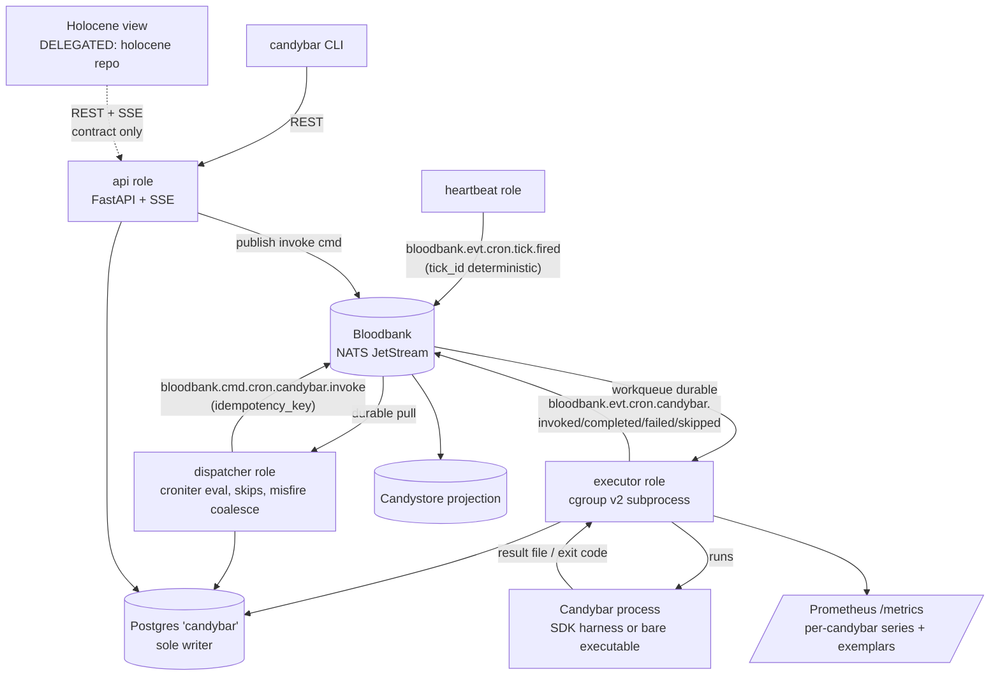
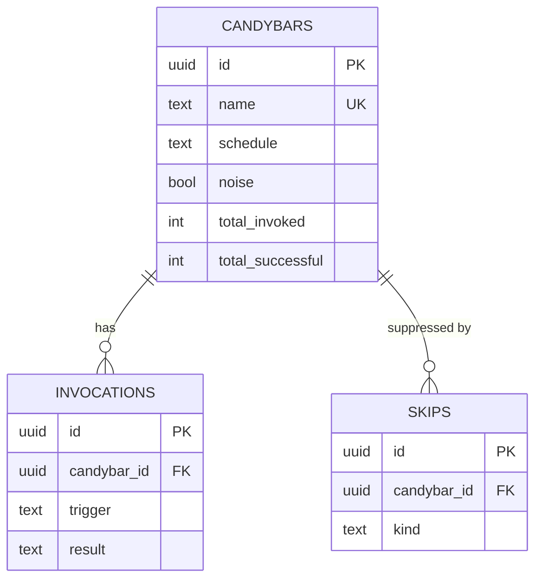

# Architecture Spine — candybar

## Design Paradigm

**Event-driven heartbeat-and-dispatch.** One clock source — the heartbeat publisher — emits minute ticks as Bloodbank facts. Every downstream behavior (schedule evaluation, dispatch, execution, accounting, live-view updates) is a consumer of bus facts and commands. Facts are choreographed; dispatch is orchestrated by a single dispatcher. There is exactly one timer in the system and it is the heartbeat publisher; nothing else may own a clock.

Roles live in one Python asyncio deployable, selected by CLI role flag (default: all roles in one process):

```text
src/candybar/
  heartbeat/    # minute-boundary tick publisher — the only timer
  dispatcher/   # tick consumer: schedule evaluation, misfire coalescing, skip honor
  executor/     # invoke-command consumer: cgroup-scoped subprocess execution + metering
  registry/     # Postgres access layer (sole writer class)
  api/          # FastAPI REST + SSE (CAP-8)
  cli/          # typer thin REST client
  events/       # envelope builders/parsers for the cron.* vocabulary
sdks/
  python/  node/  rust/    # one process protocol, three harnesses
```

## Invariants & Rules

### AD-1 — Bloodbank is the only scheduling transport

- **Binds:** CAP-1, CAP-2, all
- **Prevents:** Private timer loops, crontab entries, or in-process schedulers re-creating the scattered-cron state this product exists to kill.
- **Rule:** All time-driven behavior keys off `bloodbank.evt.cron.tick.fired` consumed from the bus. No component besides the heartbeat publisher may sleep-until-a-time to trigger work. [ADOPTED — spec constraint]

### AD-2 — One deployable, role-composed

- **Binds:** CAP-1..CAP-8
- **Prevents:** Four microservices of operational surface on a single-node homelab; divergent registry access across services.
- **Rule:** Heartbeat, dispatcher, executor, and API ship as roles of one Python process (one container, one systemd unit). A role may be split out later only behind the existing bus/API boundaries — never by sharing the registry database.

### AD-3 — Event vocabulary: domain `cron`, entities `tick` + `candybar`

- **Binds:** CAP-1, CAP-2, CAP-4, CAP-8
- **Prevents:** Ad-hoc subject shapes that violate the locked Bloodbank naming contract (the spec's assumed `bloodbank.evt.cron.heartbeat` is invalid: 3 body tokens; `heartbeat` is paired to the `system` domain).
- **Rule:** Types are exactly: `bloodbank.cron.tick.fired`; `bloodbank.cron.candybar.{created,updated,invoked,completed,failed,skipped}`; command `bloodbank.cron.candybar.invoke` (subject `bloodbank.cmd.cron.candybar.invoke`). Domain `cron`, entities `tick`/`candybar`, and action `fired` MUST be registered in `bloodbank/docs/event-naming.md` (PR-first) with JSON schemas under `bloodbank/schemas/` before first emission. Envelopes follow the naming contract: `kind`, `actor.type: "scheduler"`, `ordering_key` (`tick:<tick_id>` or `candybar:<id>`), `correlationid`/`causationid`; commands add `command_id`, `idempotency_key`, `delivery: single_consumer`.

### AD-4 — Deterministic tick identity

- **Binds:** CAP-1
- **Prevents:** Duplicate or ambiguous minute buckets when publishes are retried, replayed, or skewed.
- **Rule:** `tick_id = tick:<unix_epoch_minute>`, computed from wall-clock minute boundary; it is the event `ordering_key` and `data.tick_id`. Consumers key on `tick_id`, never on receipt time.

### AD-5 — Effectively-once dispatch, at-least-once tick

- **Binds:** CAP-1, CAP-2 *(resolves spec open question: delivery semantics)*
- **Prevents:** Double-fires from redelivered ticks or retried commands; divergent dedupe logic re-implemented per subscriber.
- **Rule:** Only the dispatcher's single durable consumer on `bloodbank.evt.cron.tick.>` evaluates schedules. Invoke commands carry `idempotency_key = candybar:<id>:tick:<tick_id>` (scheduled) or `candybar:<id>:manual:<uuid>` (manual). Any other subscriber tapping raw ticks MUST dedupe on `tick_id` (at-least-once).

### AD-6 — Misfire policy: coalesce-to-latest

- **Binds:** CAP-2 *(resolves spec open question: catch-up policy)*
- **Prevents:** Thundering-herd replay of hours of missed fires against shared homelab resources; silent loss disguised as "catch-up".
- **Rule:** On dispatcher startup, per candybar, fires missed since the last-seen tick are computed; only the LATEST missed fire executes (`trigger=misfire`); earlier missed fires are recorded as `bloodbank.cron.candybar.skipped` with `data.reason=misfire_coalesced`. Catch-up window is capped at 24h — beyond it, only the latest missed fire runs.

### AD-7 — Executor-owns-execution

- **Binds:** CAP-2, CAP-3, CAP-5, CAP-6
- **Prevents:** Two execution models (spawned vs long-running subscriber) with divergent metrics, accounting, and failure semantics.
- **Rule:** Every invocation — SDK-authored or bare executable — runs as a subprocess spawned by the executor under its own cgroup v2 scope. There are no per-candybar bus subscribers in v1 (see Deferred).

### AD-8 — SDK contract is a process protocol, identical across languages

- **Binds:** CAP-5, CAP-6
- **Prevents:** Three SDKs drifting into three contracts; SDKs acquiring bus dependencies and becoming second executors.
- **Rule:** In via env: `CANDYBAR_INVOCATION_ID`, `CANDYBAR_ID`, `CANDYBAR_TRIGGER` (`scheduled|manual|misfire`), `CANDYBAR_TICK_ID`, `CANDYBAR_RESULT_FILE`. Out: result JSON at `CANDYBAR_RESULT_FILE` — `{status: "success"|"fail", message?, metrics: {token_spend?, cost_usd?}}` where `token_spend` is total tokens consumed (input + output) as an integer and `cost_usd` is optional. Bare executables use the exit-code fallback: 0 = success, nonzero = fail, unmeasured metrics zero. SDKs never open a NATS connection. Registration metadata (name, description, tags, schedule, entrypoint) lives in a `candybar.toml` manifest the CLI/API consumes.

### AD-9 — Metrics: per-candybar series, per-invocation exemplars

- **Binds:** CAP-3
- **Prevents:** Unbounded Prometheus label cardinality from a per-invocation label (the spec's "labeled per invocation" taken literally is a cardinality bomb).
- **Rule:** Prometheus series are labeled `{candybar_id, result}` only: runtime histogram, memory max gauge, token-spend counter, cpu/gpu load summaries. Per-invocation identity rides as **exemplars** (`invocation_id`) on observations; the full per-invoke record is carried in the `completed`/`failed` event data and stored in the `invocations` table, queryable via the API. Attribution: executor measures runtime (wall ms), memory (cgroup `memory.peak`), CPU (cgroup `cpu.stat` delta / runtime), GPU (`nvidia-smi pmon` per-pid sampling when a GPU is present, else 0); token spend is self-reported by the SDK, default 0.

### AD-10 — Registry: one Postgres database, one writer, transactional counters

- **Binds:** CAP-4
- **Prevents:** Counter drift from dual-write paths; a second service class writing the registry.
- **Rule:** Database `candybar` on the shared homelab Postgres, owned solely by the daemon; alembic migrations. `total_invoked`/`total_successful` on `candybars` are updated in the SAME transaction as the terminal `invocations` row insert.

### AD-11 — CAP-8 API: REST + SSE

- **Binds:** CAP-8
- **Prevents:** A bespoke stream protocol the delegated Holocene view can't consume; contract drift from `holocene-view-contract.md`.
- **Rule:** FastAPI REST at `https://candybar.delo.sh` implementing `holocene-view-contract.md` verbatim (definitions, schedule window, noise, skips). Live updates stream over **SSE** at `GET /schedule/stream`; `GET /schedule/next` is the poll fallback. Stream events carry the contract row shape so consumers patch in place without refetch.

### AD-12 — Manual invoke rides the scheduled path

- **Binds:** CAP-7
- **Prevents:** A CLI-local execution path whose results and metrics diverge from scheduled ones.
- **Rule:** `candybar run <id>` → `POST /candybars/{id}/invoke` → API publishes `bloodbank.cmd.cron.candybar.invoke` (`trigger=manual`) → identical dispatcher/executor/registry/metrics path as a scheduled fire.

### AD-13 — croniter against the tick minute

- **Binds:** CAP-2
- **Prevents:** A jobstore/scheduler library smuggling a private timer back in (APScheduler class); bespoke cron dialects.
- **Rule:** Schedule evaluation = croniter match of standard 5-field cron against the tick minute, with active skips from the registry applied before emitting invoke commands. **All cron evaluation and fire-time computation is in UTC** — the tick minute is a UTC minute; local-time rendering is the consumer's job. Upcoming fire times for the API are computed with the same croniter calls, honoring skips.

### AD-14 — Raw NATS JetStream client

- **Binds:** CAP-1, CAP-2, CAP-7
- **Prevents:** A Dapr sidecar's operational weight on a single-process daemon for zero functional gain at this scale.
- **Rule:** nats-py: JetStream publish with dedupe (`Nats-Msg-Id` = event id), durable pull consumer for ticks, workqueue durable for invoke commands. Dapr remains a valid ecosystem transport for OTHER candybar-adjacent producers; the daemon does not require it.

### AD-15 — Deployment envelope

- **Binds:** all
- **Prevents:** New infra stores, hardcoded IPs, plaintext secrets, paid CI.
- **Rule:** One docker container on the delo.sh stack behind Traefik (`candybar.delo.sh`); Prometheus scrapes the process `/metrics`; registry on shared Postgres; secrets only as env vars holding `op://DeLoSecrets/...` references; single node, no HA; CI on GitHub-hosted runners (public repo).



## Consistency Conventions

| Concern | Convention |
| --- | --- |
| Naming (events) | Locked Bloodbank contract: type `bloodbank.cron.<entity>.<action>` (4 tokens), subject inserts kind marker (5 tokens). No provider/tool tokens in `type`; producer identity in `actor`. |
| Naming (entities) | Candybar names are unique lowercase slugs `^[a-z0-9]([a-z0-9-]*[a-z0-9])?$`; registry `id` is UUIDv7; `tick_id` is `tick:<unix_epoch_minute>`. |
| Data & formats | Timestamps ISO 8601 / RFC 3339 UTC everywhere (events, API, DB). API error shape: RFC 7807 problem+json. Result file: the AD-8 JSON shape, UTF-8. |
| State & mutation | Postgres registry is mutated only by the daemon (executor/dispatcher/API roles); every lifecycle state change ALSO emits its `bloodbank.cron.*` fact — the event and the row commit are one logical unit (event first, row in the same flow; Candystore is the durable audit). |
| Errors | Executor maps nonzero exit / missing result file to `failed` with stderr tail (max 500 chars, redacted) in event data — same redaction posture as Bloodbank maintenance events. |
| Config & secrets | Env vars only; secret values only as `op://DeLoSecrets/...` references resolved at deploy; service references are `*.delo.sh` hostnames. |
| Auth | Edge-only (Cloudflare Access / LAN) in v1; no in-app authz. |

## Stack

| Name | Version |
| --- | --- |
| Python (daemon, CLI, python SDK) | ≥ 3.13 (host: 3.14.4) |
| fastapi | 0.162.0 |
| uvicorn | 0.54.0 |
| nats-py | 2.16.0 |
| croniter | 6.2.4 |
| psycopg | 3.3.6 |
| sqlalchemy + alembic | 2.1.6 + 1.20.1 |
| prometheus-client | 0.26.0 |
| pydantic | 2.14.1 |
| typer | 0.27.3 |
| Node (node SDK floor) | 24 LTS (v24.22.1) |
| Rust (rust SDK floor) | 1.99.1 |
| Postgres (existing shared instance) | existing |
| Prometheus + Grafana (existing) | existing |
| NATS JetStream (Bloodbank) | existing |

## Structural Seed

```text
candybar/
  src/candybar/        # the one deployable (roles: heartbeat, dispatcher, executor, api)
  sdks/python/         # candybar-sdk (pip)
  sdks/node/           # candybar-sdk (npm)
  sdks/rust/           # candybar-sdk (crate)
  deploy/              # container + Traefik labels, alembic env
  schemas/             # draft JSON schemas to PR into bloodbank/schemas/
```

Registry ERD (names + relationships; attribute detail is code-owned):



## Capability → Architecture Map

| Capability / Area | Lives in | Governed by |
| --- | --- | --- |
| CAP-1 heartbeat | heartbeat role | AD-1, AD-3, AD-4, AD-5, AD-14 |
| CAP-2 Candybar contract | dispatcher + executor + SDKs | AD-1, AD-5, AD-6, AD-7, AD-8, AD-13 |
| CAP-3 metrics | executor + /metrics | AD-9 |
| CAP-4 registry | registry layer (Postgres) | AD-10 |
| CAP-5 SDKs | sdks/ | AD-7, AD-8 |
| CAP-6 executable registration | executor + CLI/API register | AD-7, AD-8 (exit-code fallback) |
| CAP-7 manual invoke | CLI + api role | AD-12 |
| CAP-8 read/control API | api role | AD-11, AD-13 (upcoming-fire computation) |
| Holocene view | holocene repo (DELEGATED) | AD-11 contract only |

## Deferred

- **Long-running SDK subscriber mode** (candybars as resident bus consumers instead of spawned processes): only if a measured cold-start cost demands it; requires per-candybar routing design the 5-token subject rule forbids encoding in the subject.
- **AuthN/Z beyond the edge**: revisit when the API is exposed beyond LAN/Cloudflare Access.
- **GPU attribution for AMD/multi-tenant sharing**: v1 is nvidia-smi-or-zero.
- **Grafana dashboards**: panels are operations work, not a consistency invariant.
- **Migration of Hermes crons / user crontab onto Candybar**: spec non-goal; adoption effort.
- **Sub-minute schedules, multi-node/HA**: spec non-goals.
- **SDK publish mechanics** (npm/pypi/crates.io distribution): packaging detail, code-owned.

## Open Questions

- Edge auth on `candybar.delo.sh`: confirm Cloudflare Access policy when the API is first exposed beyond LAN (working assumption recorded in memlog).
