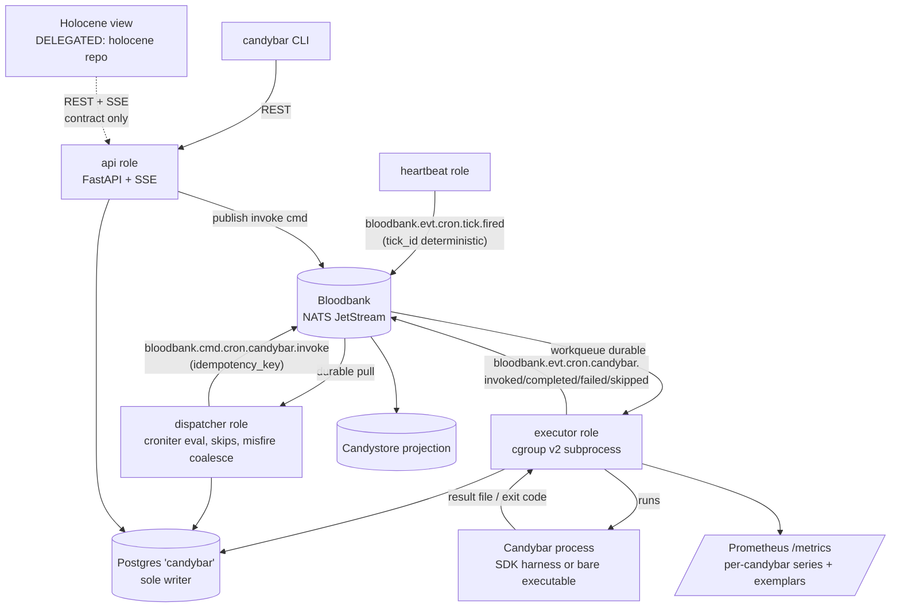
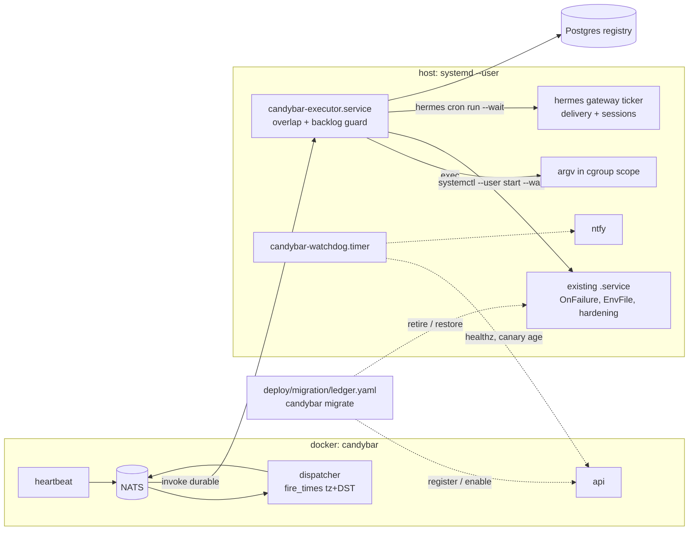
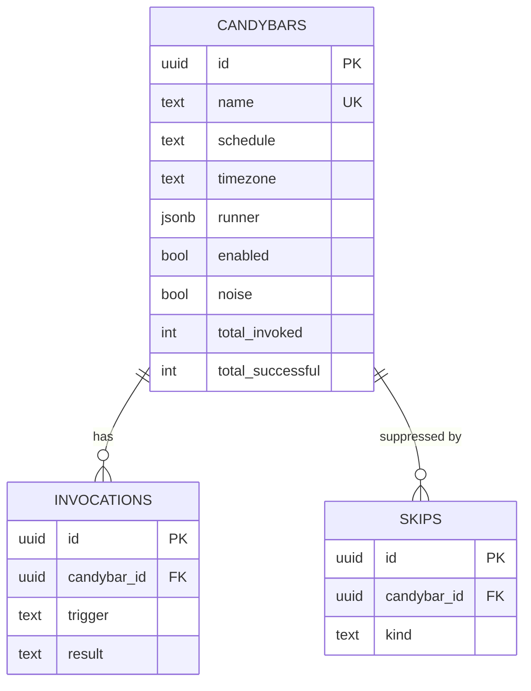

# Architecture Spine — candybar

## Design Paradigm

**Event-driven heartbeat-and-dispatch.** One clock source — the heartbeat publisher — emits minute ticks as Bloodbank facts. Every downstream behavior (schedule evaluation, dispatch, execution, accounting, live-view updates) is a consumer of bus facts and commands. Facts are choreographed; dispatch is orchestrated by a single dispatcher. There is exactly one timer in the system and it is the heartbeat publisher; nothing else may own a clock.

Roles live in one Python asyncio deployable, selected by CLI role flag (default: all roles in one process):

```text
src/candybar/
  heartbeat/    # minute-boundary tick publisher — the only timer
  dispatcher/   # tick consumer: schedule evaluation, misfire coalescing, skip honor
  executor/     # invoke-command consumer: cgroup-scoped subprocess execution + metering
  registry/     # Postgres access layer (sole writer class)
  api/          # FastAPI REST + SSE (CAP-8)
  cli/          # typer thin REST client
  events/       # envelope builders/parsers for the cron.* vocabulary
sdks/
  python/  node/  rust/    # one process protocol, three harnesses
```

## Invariants & Rules

### AD-1 — Bloodbank is the only scheduling transport

- **Binds:** CAP-1, CAP-2, all
- **Prevents:** Private timer loops, crontab entries, or in-process schedulers re-creating the scattered-cron state this product exists to kill.
- **Rule:** All time-driven behavior keys off `bloodbank.evt.cron.tick.fired` consumed from the bus. No component besides the heartbeat publisher may sleep-until-a-time to trigger work. [ADOPTED — spec constraint]

### AD-2 — One deployable, role-composed

- **Binds:** CAP-1..CAP-8
- **Prevents:** Four microservices of operational surface on a single-node homelab; divergent registry access across services.
- **Rule:** Heartbeat, dispatcher, executor, and API ship as roles of one Python codebase and one build. A role may be split out only behind the existing bus/API boundaries — never by a second codebase or a second registry access layer. *Amended 2026-10-26 (AD-17):* the executor role runs as its own host process; it shares the registry only through the same `registry/` module at the same git SHA as the container, and refuses to consume commands while the database's alembic head differs from its own.

### AD-3 — Event vocabulary: domain `cron`, entities `tick` + `candybar`

- **Binds:** CAP-1, CAP-2, CAP-4, CAP-8
- **Prevents:** Ad-hoc subject shapes that violate the locked Bloodbank naming contract (the spec's assumed `bloodbank.evt.cron.heartbeat` is invalid: 3 body tokens; `heartbeat` is paired to the `system` domain).
- **Rule:** Types are exactly: `bloodbank.cron.tick.fired`; `bloodbank.cron.candybar.{created,updated,invoked,completed,failed,skipped}`; command `bloodbank.cron.candybar.invoke` (subject `bloodbank.cmd.cron.candybar.invoke`). Domain `cron`, entities `tick`/`candybar`, and action `fired` MUST be registered in `bloodbank/docs/event-naming.md` (PR-first) with JSON schemas under `bloodbank/schemas/` before first emission. Envelopes follow the naming contract: `kind`, `actor.type: "scheduler"`, `ordering_key` (`tick:<tick_id>` or `candybar:<id>`), `correlationid`/`causationid`; commands add `command_id`, `idempotency_key`, `delivery: single_consumer`.

### AD-4 — Deterministic tick identity

- **Binds:** CAP-1
- **Prevents:** Duplicate or ambiguous minute buckets when publishes are retried, replayed, or skewed.
- **Rule:** `tick_id = tick:<unix_epoch_minute>`, computed from wall-clock minute boundary; it is the event `ordering_key` and `data.tick_id`. Consumers key on `tick_id`, never on receipt time.

### AD-5 — Effectively-once dispatch, at-least-once tick

- **Binds:** CAP-1, CAP-2 *(resolves spec open question: delivery semantics)*
- **Prevents:** Double-fires from redelivered ticks or retried commands; divergent dedupe logic re-implemented per subscriber.
- **Rule:** Only the dispatcher's single durable consumer on `bloodbank.evt.cron.tick.>` evaluates schedules. Invoke commands carry `idempotency_key = candybar:<id>:tick:<tick_id>` (scheduled) or `candybar:<id>:manual:<uuid>` (manual). Any other subscriber tapping raw ticks MUST dedupe on `tick_id` (at-least-once).

### AD-6 — Misfire policy: coalesce-to-latest

- **Binds:** CAP-2 *(resolves spec open question: catch-up policy)*
- **Prevents:** Thundering-herd replay of hours of missed fires against shared homelab resources; silent loss disguised as "catch-up".
- **Rule:** On dispatcher startup, per candybar, fires missed since the last-seen tick are computed; only the LATEST missed fire executes (`trigger=misfire`); earlier missed fires are recorded as `bloodbank.cron.candybar.skipped` with `data.reason=misfire_coalesced`. Catch-up window is capped at 24h — beyond it, only the latest missed fire runs.

### AD-7 — Executor-owns-execution

- **Binds:** CAP-2, CAP-3, CAP-5, CAP-6
- **Prevents:** Two execution models (spawned vs long-running subscriber) with divergent metrics, accounting, and failure semantics.
- **Rule:** Every invocation — SDK-authored or bare executable — is started by the executor and metered as one unit: an `exec` runner child under its own cgroup v2 scope, or (AD-18) a `systemd`/`hermes` runner whose work runs in a systemd unit or the Hermes gateway the executor starts and waits on. There are no per-candybar bus subscribers in v1 (see Deferred).

### AD-8 — SDK contract is a process protocol, identical across languages

- **Binds:** CAP-5, CAP-6
- **Prevents:** Three SDKs drifting into three contracts; SDKs acquiring bus dependencies and becoming second executors.
- **Rule:** In via env: `CANDYBAR_INVOCATION_ID`, `CANDYBAR_ID`, `CANDYBAR_TRIGGER` (`scheduled|manual|misfire`), `CANDYBAR_TICK_ID`, `CANDYBAR_RESULT_FILE`. Out: result JSON at `CANDYBAR_RESULT_FILE` — `{status: "success"|"fail", message?, metrics: {token_spend?, cost_usd?}}` where `token_spend` is total tokens consumed (input + output) as an integer and `cost_usd` is optional. Bare executables use the exit-code fallback: 0 = success, nonzero = fail, unmeasured metrics zero. SDKs never open a NATS connection. Registration metadata (name, description, tags, schedule, entrypoint) lives in a `candybar.toml` manifest the CLI/API consumes.

### AD-9 — Metrics: per-candybar series, per-invocation exemplars

- **Binds:** CAP-3
- **Prevents:** Unbounded Prometheus label cardinality from a per-invocation label (the spec's "labeled per invocation" taken literally is a cardinality bomb).
- **Rule:** Prometheus series are labeled `{candybar_id, result}` only: runtime histogram, memory max gauge, token-spend counter, cpu/gpu load summaries. Per-invocation identity rides as **exemplars** (`invocation_id`) on observations; the full per-invoke record is carried in the `completed`/`failed` event data and stored in the `invocations` table, queryable via the API. Attribution: executor measures runtime (wall ms), memory (cgroup `memory.peak`), CPU (cgroup `cpu.stat` delta / runtime), GPU (`nvidia-smi pmon` per-pid sampling when a GPU is present, else 0); token spend is self-reported by the SDK, default 0. *Amended 2026-10-26:* `systemd`-runner invocations take memory/CPU from the unit's own accounting (AD-18); `hermes`-runner token spend comes from the Hermes attempt record (AD-19).

### AD-10 — Registry: one Postgres database, one writer, transactional counters

- **Binds:** CAP-4
- **Prevents:** Counter drift from dual-write paths; a second service class writing the registry.
- **Rule:** Database `candybar` on the shared homelab Postgres, owned solely by the daemon; alembic migrations. `total_invoked`/`total_successful` on `candybars` are updated in the SAME transaction as the terminal `invocations` row insert.

### AD-11 — CAP-8 API: REST + SSE

- **Binds:** CAP-8
- **Prevents:** A bespoke stream protocol the delegated Holocene view can't consume; contract drift from `holocene-view-contract.md`.
- **Rule:** FastAPI REST at `https://candybar.delo.sh` implementing `holocene-view-contract.md` verbatim (definitions, schedule window, noise, skips). Live updates stream over **SSE** at `GET /schedule/stream`; `GET /schedule/next` is the poll fallback. Stream events carry the contract row shape so consumers patch in place without refetch.

### AD-12 — Manual invoke rides the scheduled path

- **Binds:** CAP-7
- **Prevents:** A CLI-local execution path whose results and metrics diverge from scheduled ones.
- **Rule:** `candybar run <id>` → `POST /candybars/{id}/invoke` → API publishes `bloodbank.cmd.cron.candybar.invoke` (`trigger=manual`) → identical dispatcher/executor/registry/metrics path as a scheduled fire.

### AD-13 — croniter against the tick minute

- **Binds:** CAP-2
- **Prevents:** A jobstore/scheduler library smuggling a private timer back in (APScheduler class); bespoke cron dialects.
- **Rule:** Schedule evaluation = croniter match of standard 5-field cron against the tick minute, with active skips from the registry applied before emitting invoke commands. ~~All cron evaluation is in UTC~~ *Amended 2026-10-26 (AD-16):* each candybar's cron is evaluated in that candybar's IANA `timezone` (default `UTC`, so pre-Epic-7 rows are unchanged) through the single AD-16 `fire_times()` helper; the tick minute and every stored/emitted timestamp stay UTC. Upcoming fire times for the API come from the same helper, honoring skips.

### AD-14 — Raw NATS JetStream client

- **Binds:** CAP-1, CAP-2, CAP-7
- **Prevents:** A Dapr sidecar's operational weight on a single-process daemon for zero functional gain at this scale.
- **Rule:** nats-py: JetStream publish with dedupe (`Nats-Msg-Id` = event id), durable pull consumer for ticks, workqueue durable for invoke commands. Dapr remains a valid ecosystem transport for OTHER candybar-adjacent producers; the daemon does not require it.

### AD-15 — Deployment envelope

- **Binds:** all
- **Prevents:** New infra stores, hardcoded IPs, plaintext secrets, paid CI.
- **Rule:** One docker container on the delo.sh stack behind Traefik (`candybar.delo.sh`) running heartbeat/dispatcher/api, plus (AD-17) one host `systemd --user` unit `candybar-executor.service` running the executor; Prometheus scrapes both `/metrics` endpoints; registry on shared Postgres; secrets only as env vars holding `op://DeLoSecrets/...` references; single node, no HA; CI on GitHub-hosted runners (public repo).



## Epic 7 Addendum — cron migration onto Candybar (2026-10-26)

Scope: move the 70 `migrate` jobs in [`cron-inventory.md`](../../cron-inventory.md) off user crontab, systemd user timers and Hermes cron, without changing what they do or when they fire on the wall clock. The ADs below amend AD-2, AD-7, AD-9, AD-13 and AD-15 in place and add the rules every migration-wave story shares.

### AD-16 — Per-candybar IANA timezone, one DST-correct fire-time helper

- **Binds:** CAP-2, CAP-8; dispatcher, executor (AD-20), API window/next, skips, misfire (AD-6)
- **Prevents:** Wall-clock jobs shifting one hour at the 2026-11-01 fall-back; three components hand-rolling timezone math and disagreeing (croniter 6.2.4 alone fires `40 1 * * *` twice in the repeated hour and `match()` misses spring-forward gap fires that `get_next()` returns).
- **Rule:** `candybars.timezone` is an IANA name (`zoneinfo`-validated, default `UTC`); the cron string is stored exactly as written and evaluated as local wall time in that zone. One shared helper, `fire_times(schedule, tz, start_utc, end_utc)`, is the only source of fire instants; the dispatcher's match is "tick ∈ fire_times(tick, tick+1m)". DST semantics (Vixie cron): in the fall-back hour a repeated (`fold=1`) local minute fires only when the hour field is `*`, so fixed-hour expressions fire once at the first occurrence and interval expressions keep real-time cadence; a fixed-hour expression whose wall time falls in a spring-forward gap fires once at the first existing minute after the gap, and wildcard-hour expressions do not catch up skipped wall minutes. `skip-rest-of-day`'s `date` is the candybar-local date. Ticks, `tick_id`, idempotency keys, events and API timestamps stay UTC. The definitions shape gains `timezone` (additive; `holocene-view-contract.md` is updated in the same commit, per the Epic 6 rule). [ADOPTED — orchestrator policy]

### AD-17 — Host executor, container control plane

- **Binds:** CAP-2, CAP-3, CAP-6, CAP-7; amends AD-2, AD-7, AD-15
- **Prevents:** Jobs that need the host (`systemctl --user`, `op`, docker socket, `~/`, zellij, hermes CLI) running in a container that cannot reach them; two execution environments giving one job two behaviours.
- **Rule:** The executor role runs only on the host as `systemd --user` unit `candybar-executor.service` (`candybar daemon --roles executor`, `Delegate=yes`, from the repo checkout's `.venv` at the image's git SHA, NATS and Postgres over host loopback). The container runs `--roles heartbeat,dispatcher,api`. There is no container executor and no host/container routing field: the invoke subject stays the single AD-3 subject and the single `candybar-executor-invoke` durable. The executor serves its own `/metrics` on port 8701, scraped through `host.docker.internal`. It refuses to consume while the registry's alembic head differs from its own; a deploy redeploys the container and restarts the unit together.

### AD-18 — Runner kinds: `exec`, `systemd`, `hermes`

- **Binds:** CAP-2, CAP-3, CAP-6; amends AD-7, AD-9
- **Prevents:** A migrated systemd job losing its `EnvironmentFile`, hardening, `TimeoutStartSec` or `OnFailure=` alerting; per-wave stories inventing their own wrapper scripts and metering.
- **Rule:** `candybars.runner` (jsonb) selects how the executor starts work; the bare `entrypoint` column remains the `exec` default for existing rows.
  - `exec` → `{argv[], workdir?, env{}?, timeout_s?, on_failure?}`: spawned in its own cgroup scope under the executor unit. `env` holds non-secret literals only; secrets come from the user manager's environment or `op` inside the job.
  - `systemd` → `{unit: "<name>.service"}`: the executor runs `systemctl --user start --wait <unit>`. The `.service` keeps every directive; only its `.timer` retires. Metering comes from the unit after exit: `MemoryPeak`; CPU load = `CPUUsageNSec` ÷ (`ExecMainExitTimestamp` − `ExecMainStartTimestamp`); exit from `ExecMainStatus`/`Result`; the stderr tail comes from the journal for that `InvocationID`; GPU from pmon pids in the unit's cgroup. The AD-8 env reaches the unit through a once-installed drop-in `50-candybar.conf` (`EnvironmentFile=-%t/candybar/inv/%n.env`), which the runner rewrites before each start, so there is no `daemon-reload` per run.
  - `hermes` → `{profile, job_id}`: see AD-19.
  - `on_failure` (any kind; not set on a `systemd` runner whose unit already has `OnFailure=`) is an argv the executor runs once, best-effort and unmetered, after a terminal `failed`, with `CANDYBAR_*` and `CANDYBAR_FAILURE_MESSAGE` in env.

### AD-19 — Hermes jobs keep Hermes delivery

- **Binds:** CAP-2, CAP-3; the Hermes agent-mode jobs in the inventory
- **Prevents:** Candybar re-implementing Hermes delivery, sessions, `context_from` and monitor gates; `hermes cron run` silently re-enabling the job's own schedule (its `trigger_job` sets `enabled=true` and the next natural `next_run_at`), so the job fires twice.
- **Rule:** Agent-mode jobs run as `hermes -p <profile> cron run <job_id> --wait` and execute on the gateway ticker. This needs a delorenj/hermes-agent change: a job flag `scheduler: external` that the ticker never fires on its own and that a trigger keeps external, plus `--wait`, which blocks until the durable attempt is terminal, exits 0/1 and prints its usage. The runner writes that usage (input + output tokens) into the AD-8 result file. No-agent Hermes jobs run their script directly with the `exec` runner, and an `on_failure` hook reproduces their `failure_deliver`. Hermes liveness guards (crank-watchdog) stay on the Hermes ticker.

### AD-20 — Overlap and executor-backlog coalescing

- **Binds:** CAP-2; extends AD-6
- **Prevents:** A slow run overlapping its next fire (systemd oneshots never overlap; jobs such as `telnyx-s3-intake` and `mobile-deploy-hub-catchup` depend on that); a host-executor outage replaying a queue of stale commands once the executor returns.
- **Rule:** Default `overlap: skip`. An invoke for a candybar that still has a live invocation is recorded `skipped` with `reason=overlap`. For `exec`, "live" is the single executor's in-process set; for `systemd`, the unit is `activating`/`active`. A scheduled command whose fire is more than 2 minutes old executes only when `fire_times()` has no later non-skipped fire ≤ now; otherwise it is recorded `skipped` with `reason=executor_backlog_coalesced`. The surviving command runs with `trigger=misfire`. Both skip kinds go through the same record path as dispatcher skips (`bloodbank.cron.candybar.skipped` + registry row) and the command is acked, so redelivery cannot resurrect it.

### AD-21 — Migration ledger and reversible cutover

- **Binds:** every Epic 7 wave story
- **Prevents:** A job fired by two schedulers, or by none; a rollback that needs the thing being rolled back; an installer re-run resurrecting a retired timer.
- **Rule:** `deploy/migration/ledger.yaml` (committed) holds one entry per inventory id: candybar name, runner, native schedule, cron + tz, accepted deviations, source-of-truth repo + commit, the exact disable and rollback commands, the verifying invocation id, and status `planned|cutover|verified|rolled-back`. `candybar migrate {plan,cutover,verify,rollback,status}` drives it. Cutover order: register the candybar with `enabled=false`, retire the native scheduler, then enable the candybar. Cutover is refused within 2 minutes of the job's next native fire. Rollback restores the native scheduler first and disables the candybar best-effort, so it works while the daemon is down. `candybars.enabled=false` rows are never dispatched and produce no upcoming rows in `/schedule` (definitions still list them, with `enabled`). `candybar migrate` is a REST client of the api role; it never writes the registry directly (AD-10). A job is `verified` by its first scheduled fire; external-side-effect jobs are never `candybar run` to test, and jobs that already failed natively verify on result parity.

### AD-22 — Candybar's watchdog lives off Candybar

- **Binds:** operations; complements the inventory's excluded liveness guards
- **Prevents:** A dead heartbeat, dispatcher or host executor going unnoticed because the only thing that would notice is a candybar.
- **Rule:** `deploy/watchdog/candybar-watchdog.{timer,service}` is a `systemd --user` timer every 2 minutes and is never registered as a candybar. It checks `/healthz`, that the every-minute canary candybar finished within 3 minutes, and that `candybar-executor.service` is active. It pages ntfy once per outage and again on recovery, and touches an ok-stamp that an infra-doctor `file_age` probe watches.



## Consistency Conventions

| Concern | Convention |
| --- | --- |
| Naming (events) | Locked Bloodbank contract: type `bloodbank.cron.<entity>.<action>` (4 tokens), subject inserts kind marker (5 tokens). No provider/tool tokens in `type`; producer identity in `actor`. |
| Naming (entities) | Candybar names are unique lowercase slugs `^[a-z0-9]([a-z0-9-]*[a-z0-9])?$`; registry `id` is UUIDv7; `tick_id` is `tick:<unix_epoch_minute>`. |
| Data & formats | Timestamps ISO 8601 / RFC 3339 UTC everywhere (events, API, DB); a candybar's `timezone` (IANA name) affects only which UTC instants its cron selects (AD-16). API error shape: RFC 7807 problem+json. Result file: the AD-8 JSON shape, UTF-8. |
| State & mutation | Postgres registry is mutated only by the daemon (executor/dispatcher/API roles); every lifecycle state change ALSO emits its `bloodbank.cron.*` fact — the event and the row commit are one logical unit (event first, row in the same flow; Candystore is the durable audit). |
| Errors | Executor maps nonzero exit / missing result file to `failed` with stderr tail (max 500 chars, redacted) in event data — same redaction posture as Bloodbank maintenance events. |
| Config & secrets | Env vars only; secret values only as `op://DeLoSecrets/...` references resolved at deploy; service references are `*.delo.sh` hostnames. |
| Auth | Edge-only (Cloudflare Access / LAN) in v1; no in-app authz. |

## Stack

| Name | Version |
| --- | --- |
| Python (daemon, CLI, python SDK) | ≥ 3.13 (host: 3.14.4) |
| fastapi | 0.162.0 |
| uvicorn | 0.54.0 |
| nats-py | 2.16.0 |
| croniter | 6.2.4 |
| psycopg | 3.3.6 |
| sqlalchemy + alembic | 2.1.6 + 1.20.1 |
| prometheus-client | 0.26.0 |
| pydantic | 2.14.1 |
| typer | 0.27.3 |
| pyyaml (the AD-21 ledger, `candybar migrate`) | 6.0.3 |
| Node (node SDK floor) | 24 LTS (v24.22.1) |
| Rust (rust SDK floor) | 1.99.1 |
| Postgres (existing shared instance) | existing |
| Prometheus + Grafana (existing) | existing |
| NATS JetStream (Bloodbank) | existing |

## Structural Seed

```text
candybar/
  src/candybar/        # the one deployable (roles: heartbeat, dispatcher, executor, api)
  sdks/python/         # candybar-sdk (pip)
  sdks/node/           # candybar-sdk (npm)
  sdks/rust/           # candybar-sdk (crate)
  deploy/              # container + Traefik labels, alembic env
  deploy/host/         # candybar-executor.service (AD-17)
  deploy/watchdog/     # off-candybar self-watchdog timer (AD-22)
  deploy/migration/    # ledger.yaml (AD-21)
  schemas/             # draft JSON schemas to PR into bloodbank/schemas/
```

Registry ERD (names + relationships; attribute detail is code-owned):



## Capability → Architecture Map

| Capability / Area | Lives in | Governed by |
| --- | --- | --- |
| CAP-1 heartbeat | heartbeat role | AD-1, AD-3, AD-4, AD-5, AD-14 |
| CAP-2 Candybar contract | dispatcher + executor + SDKs | AD-1, AD-5, AD-6, AD-7, AD-8, AD-13 |
| CAP-3 metrics | executor + /metrics | AD-9 |
| CAP-4 registry | registry layer (Postgres) | AD-10 |
| CAP-5 SDKs | sdks/ | AD-7, AD-8 |
| CAP-6 executable registration | executor + CLI/API register | AD-7, AD-8 (exit-code fallback) |
| CAP-7 manual invoke | CLI + api role | AD-12 |
| CAP-8 read/control API | api role | AD-11, AD-13 (upcoming-fire computation) |
| Holocene view | holocene repo (DELEGATED) | AD-11 contract only |
| Epic 7 cron migration | dispatcher + host executor + `candybar migrate` + deploy/{host,watchdog,migration} | AD-16..AD-22 |

## Deferred

- **Long-running SDK subscriber mode** (candybars as resident bus consumers instead of spawned processes): only if a measured cold-start cost demands it; requires per-candybar routing design the 5-token subject rule forbids encoding in the subject.
- **AuthN/Z beyond the edge**: revisit when the API is exposed beyond LAN/Cloudflare Access.
- **GPU attribution for AMD/multi-tenant sharing**: v1 is nvidia-smi-or-zero.
- **Grafana dashboards**: panels are operations work, not a consistency invariant.
- ~~Migration of Hermes crons / user crontab onto Candybar~~ — taken into scope 2026-10-26 by user directive as Epic 7; see the Epic 7 Addendum.
- **Jitter, boot-relative and path/event triggers** (`RandomizedDelaySec`, `OnBootSec`, `.path` units): not reproduced; a sleep-until outside the heartbeat would break AD-1. Revisit if a migrated job measurably suffers from a synchronized start.
- **Per-candybar misfire policy** (a `Persistent=false` equivalent): AD-6 applies to every candybar; revisit if a migrated job is harmed by a late catch-up run.
- **Sub-minute schedules, multi-node/HA**: spec non-goals.
- **SDK publish mechanics** (npm/pypi/crates.io distribution): packaging detail, code-owned.

## Open Questions

- Hermes `scheduler=external` + `cron run --wait` (AD-19) is a delorenj/hermes-agent change; if it cannot land, Story 7.4 falls back to a far-future Hermes schedule plus polling `hermes cron runs` (revisit at 7.4).

- Edge auth on `candybar.delo.sh`: confirm Cloudflare Access policy when the API is first exposed beyond LAN (working assumption recorded in memlog).
